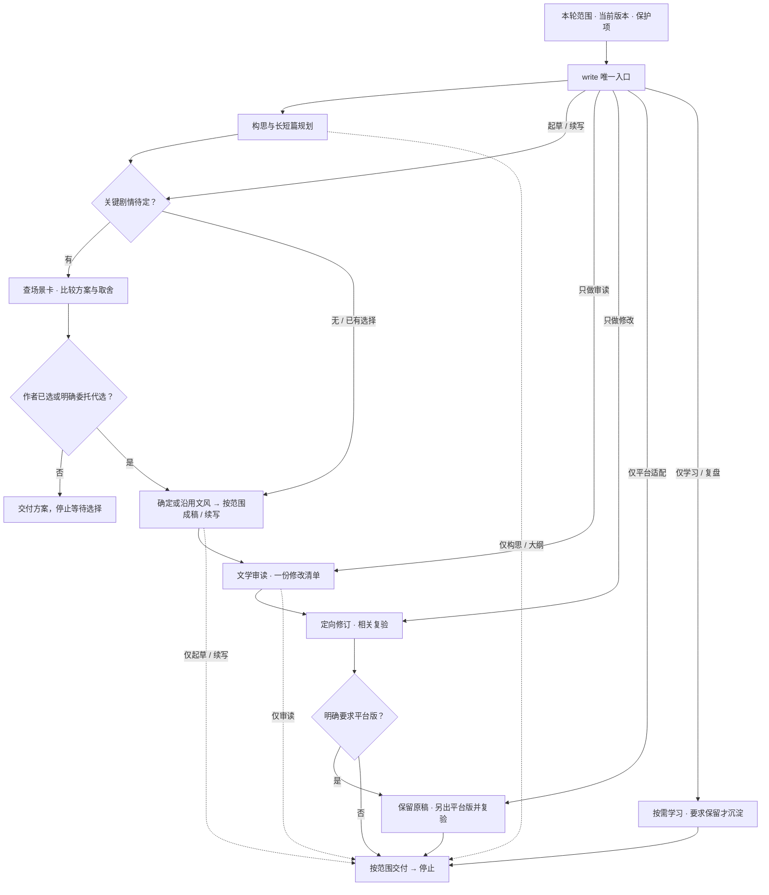

# write · 公开方法包（2026-10-24）

小说创作的一体化流程：构思 → 关键剧情方案比较 → 作者选定 → 按主题确定或沿用文风 → 连续成稿 → 文学审读 → 定向修订 → 交付；学习按需。

## 全流程一图

从作者指定的阶段接入，只走本轮所需部分；任何阶段达到交付范围即可停止。长篇保留全书方向，细化当前卷与近章；短篇围绕主要变化收束。

- **分阶段完整输出、自动继续**：在具备原生 Goal、续轮驱动器和团队任务的 DeepSeek Harness 中，可使用[执行约定](examples/AGENTS.deepseek-harness.md)。每轮完整展示当前阶段，未完的已授权范围由原生驱动继续；范围完成就停止，遇待作者选案、失败或轮数耗尽则如实停止，不自动代选或扩大任务。
- **主题与文风**：落笔前结合主题、读者体验、叙述者与人物处境选择表达取向，说明主要理由与取舍；已有文风和续写直接沿用，有实质分歧才比较，不新增例行批准点，见[起草与接续](skills/write/references/drafting.md)。主题与文风说明不提前交给独立首读者。
- **审读与修改**：默认可做内部审读。作者要求独立审读时，A 与 B 第一轮各用未继承主笔历史的新上下文，B 保存初评后在同一上下文续接第二轮；先验不明或带作品背景时如实降级。修改若改变已选关键剧情，也先回到方案比较与作者选择，见[审读协议](skills/write/references/editorial.md)。
- **可选分支**：[平台适配](skills/write/references/platform-adapt.md)仅明确要求时启用，涉及关键剧透或揭示重排仍先选案，不承诺平台效果；[学习回路](skills/write/references/learning.md)按需进入，不自动回写旧笔记或方法库。

## 使用与边界

- 入口：`skills/write/SKILL.md`
- 结构参考：`skills/write/references/structures-summary.md`（通用安排摘要；不含具体书目、章号或项目案例）
- 平台适配（可选，默认关闭）：`skills/write/references/platform-adapt.md`；只在作者明确要求时用，不改剧情事实；涉及已选揭示、知情或悬念时先选案。
- 方法：只含通用方法摘要与虚构格式例；不含小说正文、真实案例、私人阅读笔记、阅读进度、读者身份、凭据或本机绝对路径。
- 第三方：`skills/write/scripts/` 下两个检测器及一个辅助模块为 oh-story-claudecode@7408014 的 MIT 复制件，许可见 `skills/write/THIRD_PARTY_NOTICES.md`。
- 用法：把 `skills/write/` 放进技能目录，读 `SKILL.md`；检测器可选（Node，无 npm）。
- 状态：方法效果待试验；机器检查只证明所检查事项，不代表文学质量。

- DeepSeek Harness 可选执行约定：[分阶段完整输出与自动继续](examples/AGENTS.deepseek-harness.md)；需应用已有原生 Goal、续轮驱动器和团队任务，不改变通用写作入口。
